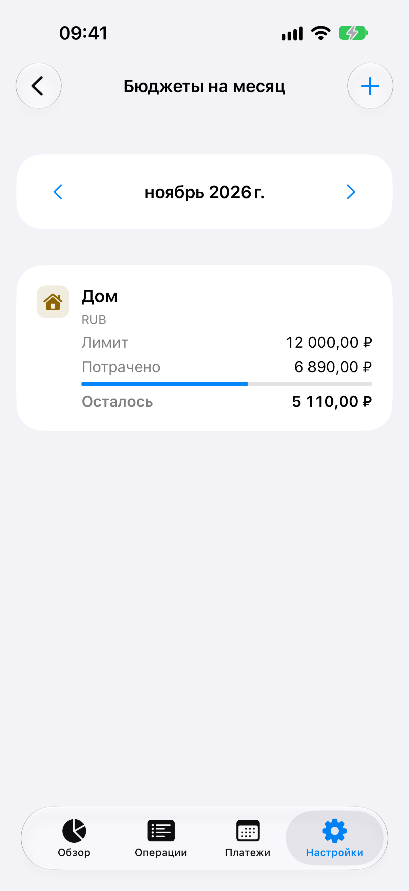

# iWallet

iWallet помогает вести доходы и расходы на iPhone, следить за бюджетом по категориям и видеть предстоящие платежи. Записи хранятся на устройстве. Требуется iOS 17 или новее.

[Скачать iWallet в App Store](https://apps.apple.com/app/apple-store/id6447585809?pt=126245738&ct=github-project&mt=8) · [Руководство и поддержка](docs/SUPPORT.md#русский)

Track spending on your iPhone, set a monthly grocery budget and see which bills are due in the next seven days. [Download on the App Store](https://apps.apple.com/app/apple-store/id6447585809?pt=126245738&ct=github-project&mt=8) · [Support in English](docs/SUPPORT.md#english)

<a href="https://apps.apple.com/app/apple-store/id6447585809?pt=126245738&amp;ct=github-project&amp;mt=8">
  
</a>

## Возможности

- Четыре нативные вкладки: **Обзор, Операции, Платежи, Настройки**.
- Баланс, доходы, расходы и средний расход по дням с расходами. Фильтры валюты и периода; по умолчанию «Месяц».
- Интерактивные Swift Charts: доходы/расходы по времени, сравнение с предыдущим периодом и распределение по категориям. Точные суммы доступны текстом; разные валюты не объединяются и не конвертируются.
- История с поиском, фильтрами, редактированием и подтверждением удаления. Архивирование категории сохраняет операции и связанные планы платежей.
- Регулярные расходы и подписки: неделя, месяц или год, дата следующего платежа, пауза и возобновление. **Расход появляется только после явного «Оплачено»**; пропуск сдвигает один период без расхода.
- Расписание сохраняет исходный день и часовой пояс: 31-е число возвращается после короткого месяца, 29 февраля — в следующий високосный год. Просроченные периоды не проводятся автоматически.
- Прогноз от сегодняшнего дня включает каждое повторение в выбранной валюте. Первый открытый просроченный срок учтён отдельно. У каждого плана свой часовой пояс.
- Уведомления включаются на этом устройстве по желанию. Можно выбрать день платежа или накануне и время по часовому поясу плана. iOS показывает общий текст и по нажатию открывает «Платежи».
- Бюджет задаётся для отдельного месяца, расходной категории и валюты. Расходы за этот месяц показывают, сколько осталось или на сколько превышен лимит.
- JSON-экспорт и восстановление: одинаковые записи пропускаются, конфликтующие ID отклоняют весь импорт. Формат v3 включает расписания и бюджеты. Поддерживается импорт v1 и v2. Настройки уведомлений остаются на устройстве.
- Доступны 11 языков интерфейса — английский, русский, китайский (упрощённое письмо), хинди, испанский, арабский, французский, бенгальский, португальский, индонезийский и урду. Арабский и урду поддерживают интерфейс справа налево. Имена сохранённых категорий и заметки остаются на языке ввода.

Все записи хранятся локально в SwiftData, без CloudKit, аккаунта, рекламы и аналитических сервисов. Деньги — `Int64` в минимальных единицах валюты, расчёты — `Int64`/`Decimal`; `Double` используется только для отрисовки графиков.

Переходный релиз включает **Realm Swift 20.0.6** исключительно для переноса прежней базы. Reader открывает рабочую копию; исходник и проверенная резервная копия сохраняются. Валюту и округление подтверждает пользователь. Полные уведомления о лицензиях доступны в «Настройки → Лицензии».

## Запуск и тесты

Откройте `iWallet.xcodeproj`, выберите схему **iWallet** и iOS Simulator. Для физического устройства настройте signing своей Apple Developer Team. Локально используется Xcode 27.2.

```sh
xcodebuild -project iWallet.xcodeproj -scheme iWallet \
  -configuration Debug -destination 'generic/platform=iOS Simulator' \
  -derivedDataPath build/DerivedData CODE_SIGNING_ALLOWED=NO build

swift test -j 2
Scripts/verify-localizations.py --app build/DerivedData/Build/Products/Debug-iphonesimulator/iWallet.app
```

Тесты SwiftData выполняются на macOS 14+ с временными базами, не с личным кошельком.

| Проверка | Подтверждённый результат |
| --- | --- |
| Build 6 | 123 модульных теста прошли полным прогоном (107 core, 16 legacy). Два новых UI-сценария на iPhone Simulator прошли, включая системное разрешение iOS, расчёты и перезапуск |
| Обновление установленного build 5 → 6 | Пользовательские поля 7 операций, 12 категорий и 2 планов совпали до и после обновления |
| Unit-тесты build 5 | **95 PASS** полным прогоном: 79 core и 16 legacy; затем **1 PASS** отдельно для отката неудачного ручного INSERT. Единого полного прогона 96 не было |
| Приложение build 5 | **TEST BUILD SUCCEEDED**; `/tmp/iwallet-build5-test-build-final.log` |
| Обновление установленного build 4 → 5 | 7 операций и 12 категорий сохранены, пользовательские поля совпали; `build/QA/design5-upgrade/comparison.json` |
| UI build 5 | CRUD/архив/перезапуск, черновик, полный цикл подписки и Realm-перенос — четыре сценария PASS в отдельных прогонах; подробности в RESTORATION |
| Визуальная проверка build 5 | 18 RU/EN, 9 Dark и 29 AX-кадров; capture-тесты PASS, просмотрены и нижние строки длинных экранов |
| Релизный пакет build 5 | Signed archive, App Store export и deep/strict codesign — PASS; `build/QA/build5-ipa-validation.json`. Upload успешен, завершение обработки Apple не подтверждено |

Проверены атомарная оплата и пропуск, повторные подтверждения, часовые пояса/DST, месяцы/високосные годы, откат ошибок, JSON v1/v2 и обновление прежней SwiftData-схемы. [Историческая Realm-фикстура](Tests/Fixtures/README.md) создана настоящим Realm Cocoa 10.40.0 / Core 13.13.0, schema 15, формат 23; перенос сохраняет её исходные байты. Личной старой базы владельца нет. Это не заменяет обновление установленной версии 1.1.8 на физическом устройстве.

Три снимка показывают [прогноз](docs/images/planning/forecast.png), [месячный бюджет](docs/images/planning/budget.png), [напоминания](docs/images/planning/reminders.png).

Девять русских превью предыдущего build 5 доступны в [docs/images/design5](docs/images/design5); [полные снимки и протокол](docs/APPSTORE-SCREENSHOTS.md).

## Выпуск

На 10 ноября 2026 года в App Store доступна версия **2.0.0** с бюджетами, прогнозом платежей и локальными напоминаниями. Версия **2.1.0 (9)** с обновлённым интерфейсом отправлена на проверку Apple. Сборка **2.2.0 (11)** загружена в TestFlight. До покупки в ней можно менять даты в примере отчёта. Разовая покупка открывает отчёты по расходам своего кошелька и сохранение в PDF. [Изменения интерфейса](https://github.com/nvavna/iWallet-1/pull/3) · [Отчёты о расходах](https://github.com/nvavna/iWallet-1/pull/4)

- [Ход восстановления и доказательства предыдущих сборок](docs/RESTORATION.md)
- [Протокол переноса Realm](docs/LEGACY-MIGRATION.md)
- [Подготовка App Store](docs/APP-STORE-RELEASE.md)
- [Договор дизайна и проверки доступности](docs/DESIGN.md)
- [Воспроизведение снимков](docs/APPSTORE-SCREENSHOTS.md)

Проект продолжает [первое приложение iWallet](https://github.com/iWalletTeam/iWallet) и использует его Bundle ID `com.idevnva.iwallet`. Версия 1.1.8 сохранена в Git (`b521ad4`). Актуальный код на SwiftUI и SwiftData находится в ветке `main`.
