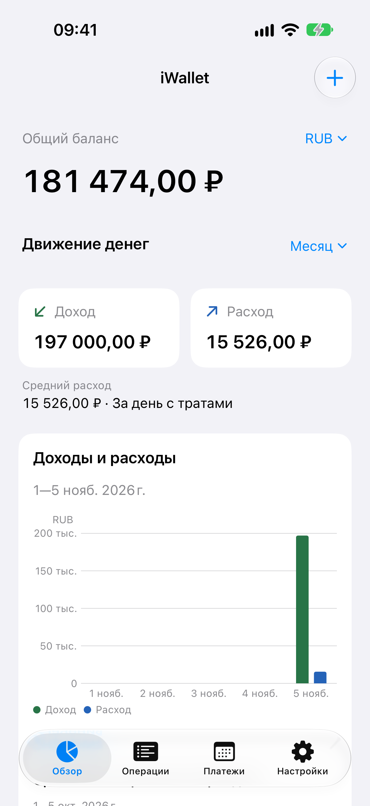
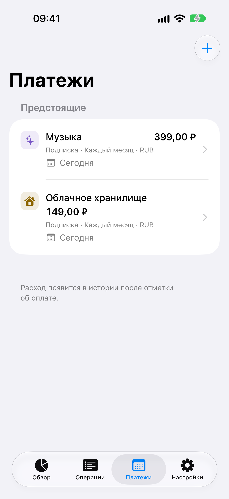
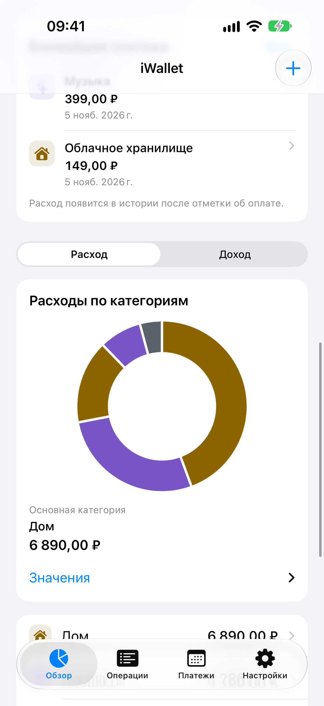

# Дизайн iWallet — build 5

5 ноября 2026. Нативное приложение для iPhone на SwiftUI, iOS 17+. Новый дизайн опирается на Apple HIG; полное соответствие и поддержка VoiceOver пока не заявлены. В черновике App Store выбран build 2 с его материалами. Build 5 подписан и загружен для обработки; этот документ описывает его интерфейс.

## Навигация и визуальная система

Четыре постоянные вкладки: **Обзор, Операции, Платежи, Настройки**. Каждая имеет собственный NavigationStack. Добавление — системная toolbar-кнопка, редактирование — Form в sheet. Категории открываются из настроек, история категории — из обзора. Используются системные шрифты, семантические фоновые цвета, SF Symbols с проверкой доступности символа и стандартные компоненты iOS. Иконка приложения сохранена.

Слой навигации получает оформление текущей iOS через стандартные компоненты. Собственный blur и стеклянные подложки у финансовых карточек не добавляются. Отступы 16–24 pt, группировка по смыслу, один синий акцент для действий. Большие суммы переносятся; при accessibility-размерах горизонтальная сводка становится вертикальной. Формы показывают подписи и выбранные значения на разных строках, чтобы длинная категория не терялась в узком Picker.

Обоснования Apple: [Tab bars](https://developer.apple.com/design/human-interface-guidelines/tab-bars), [Toolbars](https://developer.apple.com/design/human-interface-guidelines/toolbars), [Materials](https://developer.apple.com/design/human-interface-guidelines/materials), [Typography](https://developer.apple.com/design/human-interface-guidelines/typography), [SF Symbols](https://developer.apple.com/design/human-interface-guidelines/sf-symbols).

## Обзор и графики

- Общий баланс — вся история выбранной валюты. Планы платежей его не меняют.
- Сводка и графики — месяц, квартал, год или всё время. По умолчанию месяц. Для календарного периода показан диапазон от его начала до конца текущего дня; будущие дни не выдаются за нулевые траты.
- Сравнение использует столько же прошедших календарных дней предыдущего периода, с ограничением его длиной. Точные даты показаны. При нулевой прошлой сумме процент не вычисляется.
- Столбцы Swift Charts показывают доходы и расходы по времени. Касание раскрывает точные суммы выбранного интервала. «Значения» даёт текстовый список. При accessibility-размерах плотный график заменяется выбором интервала и крупными точными значениями: фиксированные оси не накладываются друг на друга.
- Кольцевая диаграмма показывает пять крупнейших категорий и «Другие категории». Под ней остаётся полный список категорий с суммами и переходом в историю. Идентификатор категории, а не её название, определяет группировку.
- Средний расход делится на календарные дни с расходами. Это прямо указано рядом со значением.
- Ближайшие три активных платежа показаны отдельно от фактических расходов. «Все» открывает вкладку Платежи.
- Разные валюты не суммируются и автоматически не конвертируются. Баланс и расчёты используют Int64/Decimal, Double применяется только для координат графиков. При переполнении показана ошибка вместо нуля.

Данные графика ограничены разумным числом интервалов: дни месяца, недели квартала, месяцы года, не более 24 интервалов всей истории. Пустое состояние объясняет отсутствие операций. Подписи и текстовые значения дополняют цвет. Дата обновляется раз в минуту и при возвращении приложения на передний план.

[Apple Charts](https://developer.apple.com/design/human-interface-guidelines/charts) рекомендует выбирать тип графика по смыслу данных, снабжать его контекстом и доступными описаниями. [Charting data](https://developer.apple.com/design/human-interface-guidelines/charting-data) — основание для выбора небольшого числа полезных представлений вместо множества декоративных графиков.

## Регулярные платежи и подписки

Вкладка разделяет просроченные, предстоящие и приостановленные планы. У плана есть имя, сумма, валюта, категория расходов, периодичность (неделя/месяц/год), дата, часовой пояс и признак подписки.

«Отметить оплаченным» после подтверждения записывает один расход с сегодняшней датой и переносит срок ровно на один период. «Пропустить» сдвигает срок без расхода. Пауза сохраняет план, удаление плана сохраняет финансовую историю. Просроченный на несколько периодов план может остаться просроченным после одного действия: приложение не создаёт задним числом неизвестные расходы. Банковские списания не выполняются.

Исходный день сохраняется: 31 января → 28 февраля → 31 марта; 29 февраля возвращается в високосном году. Часовой пояс записан вместе с планом. Повторное устаревшее подтверждение отклоняется. Архивированную или утраченную категорию необходимо заменить перед записью расхода.

Изменение сохраняется одним commit в отдельном ModelContext. После успеха приложение открывает свежий ModelContainer и возвращает пользователя к корню той же вкладки; фильтры обзора сохраняются. Это исключает чтение старых зарегистрированных моделей. При ошибке черновик и прежние данные остаются доступны. JSON v2 включает планы, импорт прежнего v1 поддерживается.

Локальных уведомлений в этом срезе нет: напоминания требуют отдельного opt-in и проверки расписания после паузы, редактирования и смены часового пояса.

## Проверки и границы

Подтверждено: 95 тестов хранения/расчётов/миграции, 0 ошибок; компиляция приложения build 5. Установка build 5 поверх настоящей демобазы build 4 сохранила 7 операций и 12 категорий: пользовательские поля идентичны; изменился только внутренний номер entity SwiftData. Доказательство: `build/QA/design5-upgrade/comparison.json`.

Четыре UI-сценария build 5 прошли в отдельных прогонах. Оба capture-теста PASS; 18 RU/EN-снимков просмотрены. Результаты build 4 (три UI-сценария, 12 RU/EN-снимков, Dark и AX) относятся к предыдущему интерфейсу и не заменяют проверку новых графиков и платежей.

До выпуска остаются: физический iPhone, минимальная iOS 17, полный VoiceOver, Increase Contrast/Reduce Transparency/Reduce Motion, окончательная проверка нижних элементов длинных экранов и системного экспорта/импорта. Предупреждение `Invalid frame dimension (negative or non-finite)` при открытии клавиатуры наблюдалось в предыдущих сборках; устранение пока не заявляется.

[Apple Accessibility](https://developer.apple.com/design/human-interface-guidelines/accessibility) требует проверять изменение размера текста, контраст и несколько способов восприятия информации. Наличие системных компонентов и accessibility labels само по себе не доказывает прохождение такого аудита.

## Следующий полезный функционал

1. Локальные напоминания о платежах по согласию пользователя; отмена устаревших уведомлений после каждого изменения.
2. Предстоящие суммы за 7/30 дней отдельно по валютам и явно отдельно от баланса. Расчёт должен включать все повторения внутри окна.
3. Месячные бюджеты категорий с остатком и предупреждением о приближении к лимиту.
4. Быстрый ввод повторяющихся операций через шаблоны/Shortcuts после проверки базового сценария.

Счета, банковские интеграции и синхронизация требуют отдельного решения: сейчас они увеличат сложность и объём проверки данных сильнее, чем пользу для первого восстановленного выпуска.

## Реальные экраны build 5

| Обзор | Платежи | Категории расходов |
| --- | --- | --- |
|  |  |  |

[График по времени](images/design5/08-analytics.png) · [Операции](images/design5/02-transactions.png) · [Новая операция](images/design5/04-new-transaction.png). Это неизменённые native PNG с синтетическими данными.

## Финальная проверка Dark и крупного текста

`build/UITests-Build5-Dark-Final.xcresult` — PASS, 81,936 с; девять оригинальных кадров в `build/QA/design5-dark-final/`. Оба графика визуально помещаются над tab bar, подписи и значения читаемы.

`build/UITests-Build5-AX-Final.xcresult` — PASS, 162,530 с; 29 кадров в `build/QA/design5-ax-final/`. Проверен альтернативный текстовый просмотр временных интервалов без наложения осей, перенос суммы/категории/заметки. Дополнительные bottom assertions и изображения подтверждают видимость последней операции и строки хранения над tab bar. Русский симулятор после проверки возвращён в light/large.

Capture-helper объединяет frames всех элементов с ID карты: SwiftUI переносит этот ID на несколько дочерних AX-элементов. Геометрия записана в attachments. Это исправление съёмки, не изменение финансовых данных. Эти результаты не заменяют VoiceOver и физический iPhone.
