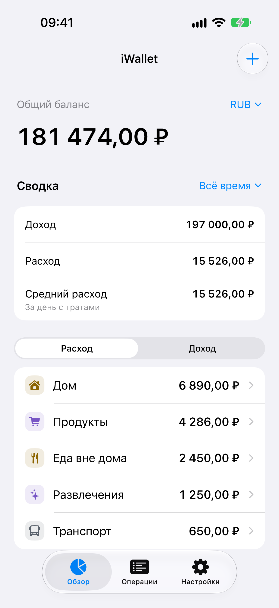
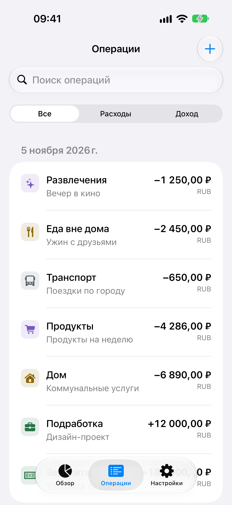
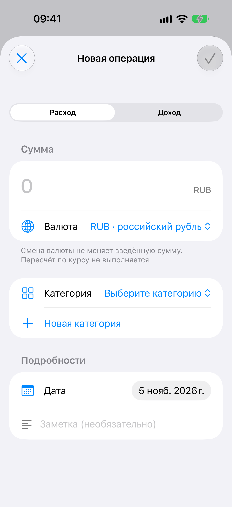

# Дизайн iWallet: нативный интерфейс по Apple HIG

Дата исследования: **5 ноября 2026 года**. Это договор для редизайна всех экранов **после промежуточного build 3; текущая локальная реализация — build 4**. Три нативные вкладки, формы, SF-badges и палитра реализованы; сборка симулятора прошла (`/tmp/iwallet-design4-build.log`, `BUILD SUCCEEDED`). Runtime-, UI- и полный accessibility-аудит build 4 ещё не завершены. Предыдущие снимки/тесты build 2 и компактного Home build 3 не подтверждают новый интерфейс. Полное соответствие HIG и поддержка VoiceOver не заявляются до проверки.

Цель — спокойный интерфейс личного учёта: понятная иерархия денег, короткие действия, стандартная навигация iOS. Сохраняются SwiftData, точные суммы, разделение валют, перенос Realm с согласием и смысл JSON-импорта. Иконка приложения не перерабатывается. Редизайн не добавляет банковское подключение, обмен валют, бюджеты, синхронизацию или декоративные графики. Apple связывает простоту с полезностью и ясной иерархией, а не с удалением необходимых возможностей: [Design principles](https://developer.apple.com/design/human-interface-guidelines/design-principles).

## Основания и выбранные решения

| Рекомендация Apple | Договор iWallet |
| --- | --- |
| Tab bar переключает верхнеуровневые разделы; действия относятся к toolbar. Число вкладок определяется структурой приложения, а не фиксированным правилом «ровно три». | Три постоянные вкладки: **Обзор / Overview**, **Операции / Transactions**, **Настройки / Settings**. «Добавить» не становится вкладкой. Это продуктовое решение iWallet. [Tab bars](https://developer.apple.com/design/human-interface-guidelines/tab-bars) |
| В toolbar следует оставлять важные действия, использовать стандартные компоненты и избегать перегруженного оформления. | Добавление — системная toolbar-кнопка с SF Symbol и доступным названием. Никаких собственных панелей поверх tab bar. [Toolbars](https://developer.apple.com/design/human-interface-guidelines/toolbars) |
| Liquid Glass предназначен прежде всего для слоя навигации и контролов; стандартные компоненты получают системное оформление автоматически. | Финансовые блоки используют системные фоны. Не превращать суммы, строки и каждую карточку в стекло. На iOS 17 сохраняется её нативный внешний вид; новые эффекты не имитируются вручную. [Materials](https://developer.apple.com/design/human-interface-guidelines/materials) |
| Семантические цвета учитывают appearance и accessibility; один цвет должен иметь последовательный смысл. | Синий системный tint — действия и выбор, `.primary` — основные данные, `.secondary` — пояснения. Красный относится к удалению/ошибке; тип операции дополнительно передаётся текстом и знаком. [Color](https://developer.apple.com/design/human-interface-guidelines/color) |
| Системные стили текста задают иерархию и поддерживают Dynamic Type. | System font, семантические стили, перестройка строк при большом тексте. Суммы не сокращаются и не уменьшаются ради фиксированной высоты. [Typography](https://developer.apple.com/design/human-interface-guidelines/typography) |
| SF Symbols согласованы с системным шрифтом; доступность отдельных символов зависит от ОС. | Один компонент значка категории, одинаковый во всех списках и формах. Совместимость символов ещё нужно проверить на iOS 17; неизвестный цвет отображается через синий fallback. SF Symbols не используются как новый логотип или app icon. [SF Symbols](https://developer.apple.com/design/human-interface-guidelines/sf-symbols) |
| Sheet подходит для отдельной короткой задачи; несколько sheet друг над другом затрудняют возврат. | Создание и редактирование — один sheet с ясным названием. Дочерний выбор/создание категории — push внутри его стека, а не ещё один sheet. [Sheets](https://developer.apple.com/design/human-interface-guidelines/sheets) |
| Модальность должна иметь понятный выход; при потере введённого содержимого требуется предупреждение. | Отмена и свайп закрытия изменённого черновика не теряют ввод без явного решения. Ошибка сохранения оставляет форму открытой. [Modality](https://developer.apple.com/design/human-interface-guidelines/modality) |
| `Form` группирует стандартные элементы ввода с оформлением платформы. | Формы и настройки — `Form`/`Section`; данные — `List` либо адаптивный контент обзора. Не рисовать собственные версии переключателей и полей. [Form](https://developer.apple.com/documentation/swiftui/form), [Container views](https://developer.apple.com/documentation/swiftui/picking-container-views-for-your-content) |

## Навигация

| Раздел | Переходы и действия |
| --- | --- |
| Обзор | Главный баланс → компактная сводка → категории выбранного типа. Категория открывает её историю через push. Toolbar «Добавить операцию» открывает форму с выбранными типом и валютой. |
| Операции | Полная история, поиск, фильтр типа. Нажатие записи открывает редактор. Toolbar добавляет операцию. Это самостоятельный корневой раздел, без кнопки «Готово» для закрытия вкладки. |
| Настройки | Настройка валюты, переход в категории, импорт/экспорт, приватность, поддержка, лицензии и версия. Категории и информационные страницы открываются через push. |
| Категории | Дочерний экран настроек со стандартным Back. Добавление категории — sheet. Архивирование объясняет сохранение связанных операций. |
| История категории | Дочерний экран обзора со стандартным Back. Сохраняет валюту исходного выбора, показывает все даты, а не только период сводки; этот контекст должен быть понятен на экране. |
| Редакторы | Отдельная краткая задача: Cancel/«Отмена» слева, Save/«Сохранить» справа. После успеха возвращают в исходное место; никакого переключения вкладки. |

Корень каждой вкладки имеет собственный `NavigationStack`. Переключение вкладок сохраняет её путь и локальные фильтры, а не пересоздаёт кошелёк. При обычном push tab bar остаётся доступным; форма может закрыть его как временная модальная задача. Пустой раздел не исчезает и не блокирует вкладку. Это применение [Tab bars](https://developer.apple.com/design/human-interface-guidelines/tab-bars).

Категории не выделяются в четвёртую вкладку: их управление нужно реже, чем ввод и просмотр операций. История при этом доступна одним нажатием, без открытия настроек. Риск выбранной структуры — обнаружение управления категориями; он проверяется заданием «создать новую категорию» на чистой установке, а не предположением о привычках пользователя. Создание категории также доступно из редактора операции.

Не сохранять старые дублирующие маршруты «Настройки → Операции» и отдельный sheet полной истории. Если обзор содержит ссылку «Все операции», она выбирает вкладку Операции, а не создаёт вторую независимую историю. Символы и краткие подписи вкладок остаются видимыми; не добавлять badge без информации, требующей внимания.

## Визуальная система

Следующие численные значения — **выбор проекта**, а не утверждение об обязательных размерах Apple.

| Элемент | Правило |
| --- | --- |
| Фоны | `systemBackground` / `systemGroupedBackground` и соответствующие secondary-фоны по роли. Не перекрашивать toolbar/tab bar и не накладывать собственный blur. |
| Акцент | Системный синий для доступных действий/выбора; обычные суммы не окрашиваются в action tint. Системное оформление выбранного tab не переопределяется вручную. |
| Иерархия | Один главный баланс. Доходы, расходы и среднее компактнее. Не делать все блоки одинаково крупными и яркими. |
| Шрифт | Заголовки экранов — native navigation title. Баланс — `.largeTitle` с semibold; основные строки — `.body`, суммы строк — `.body`/`.headline`; пояснения — `.subheadline`/`.footnote`. Цифры могут быть monospaced, текст остаётся системным. |
| Отступы | Нативные отступы `List`/`Form` сохраняются. Для собственных блоков обзора: ориентир 16 pt по краям, 12–16 pt внутри блока, 24 pt между смысловыми разделами. Не фиксировать высоту содержимого. |
| Значок категории | Один SF Symbol внутри спокойной компактной подложки. В строках используется фиксированный декоративный badge 32 pt, в Home — 28 pt; он не масштабируется с Dynamic Type и исключается из VoiceOver как дубль названия. Значимая текстовая подпись масштабируется отдельно. |
| Палитра категорий | Сохранённые идентификаторы цветов остаются частью данных. Новая light/dark-палитра применяется при отображении; неизвестный/пустой цвет получает **синий fallback** без переписывания значения. Increase Contrast и фактический фон ещё требуют проверки. |
| Разделение | Системные separators и секции. Тени, градиенты, цветные рамки, декоративные линии и диаграммы не нужны для объяснения текущих данных. |
| Нажатия | Для собственных интерактивных элементов целевая область не менее **44×44 pt**. HIG сейчас указывает 44×44 как default iOS и отдельно меньший minimum; проект сознательно выбирает более крупную цель. [Accessibility](https://developer.apple.com/design/human-interface-guidelines/accessibility) |

Составная строка операции использует значок, категорию/заметку и сумму с валютой. На обычном размере текста сумма может стоять справа; при нехватке места она переносится отдельной строкой. Знак операции, дробная часть и валюта должны оставаться читаемыми. Не заменять длинные суммы форматом «1,2M» и не скрывать копейки. Длинная заметка может иметь краткий preview, если полный текст доступен в редакторе; данные не обрезаются при сохранении.

Для glyph текущей палитры математически рассчитан контраст на 12% tint-подложке поверх белого и тёмного `#1c1c1e`: минимумы **4,54:1 в light** и **6,35:1 в dark**. Расчёт относится только к этим цветам и фонам; он не измеряет реальный raster, все состояния, Increase Contrast или остальные тексты приложения и не заменяет Accessibility Inspector. Системные цвета и шрифты — исходная точка, а не доказательство доступности. [Color](https://developer.apple.com/design/human-interface-guidelines/color), [Typography](https://developer.apple.com/design/human-interface-guidelines/typography).

## Договор экранов и состояний

### Обзор

Порядок: баланс → валюта/период → компактная сводка → выбор Расход/Доход → категории. Баланс всегда включает всю историю выбранной валюты, что явно подписано. Доходы, расходы и среднее используют выбранный период; начальный период — «Всё время».

Средний расход — сумма расходов выбранной валюты и периода, делённая на число календарных дней, когда были расходы. Дни без расходов не входят в знаменатель. Название или доступное рядом пояснение должно отличать этот показатель от среднего за каждый календарный день месяца. Никаких молчаливых изменений расчёта ради нового макета.

Валютное меню не выполняет конвертацию. Список категорий соответствует выбранным типу, валюте и периоду, не сокращается до произвольных первых трёх. На пустом экране показывается спокойное объяснение и доступное добавление. Ошибка переполнения не отображается как нулевой баланс. На accessibility-размерах компактная сводка перестраивается вертикально.

### История и редактор операции

История сохраняет поиск по заметке, категории и валюте, фильтр типа, группировку по календарным дням и существующие условия category/currency scope. Строка целиком доступна для открытия. Удаление имеет явное подтверждение и путь, доступный без жеста swipe. Архивная категория остаётся понятной частью прежней операции.

Форма сохраняет сумму, тип, категорию, дату, заметку и валюту. Метки полей остаются понятными после ввода; placeholder не заменяет постоянное название. Сумма принимает поддержанные локалью разделители и цифры, а проверки сохраняют точность/переполнение. Decimal keyboard имеет видимый способ закрытия. Ошибка рядом с полем поясняет, что исправить; ошибка записи не уничтожает введённые значения. [Text fields](https://developer.apple.com/design/human-interface-guidelines/text-fields).

Новая категория в редакторе — короткий push-шаг в текущем `NavigationStack`. В build 4 системный Back этого редактора скрыт: явная **Cancel/«Отмена»** вызывает проверку изменённого черновика и при необходимости предлагает продолжить редактирование либо отбросить изменения. Save сохраняет категорию и возвращает к операции; сумма, дата, заметка и валюта её черновика не сбрасываются. Это отличается от обычных push-списков, где остаётся системный Back. Интерактивное закрытие изменённой формы блокируется; явный выход доступен через Cancel. Поведение ещё нужно подтвердить runtime-тестом. [Sheets](https://developer.apple.com/design/human-interface-guidelines/sheets), [Modality](https://developer.apple.com/design/human-interface-guidelines/modality).

В истории активной категории добавление подставляет её и текущую валюту. В истории архивной категории добавление скрыто; старые операции остаются доступны. Изменение валюты операции сохраняет введённое числовое значение и не объявляется обменом по курсу.

### Категории

Список разделяет доходные и расходные категории. Выбор типа — контекст списка, не дополнительная навигация верхнего уровня. Название, значок и цвет образуют один согласованный компонент в обзоре, истории и редакторе.

Редактор использует системную форму; выбор значка/цвета имеет названия и состояние selected для assistive technologies. Для фиксированного набора сохранённых цветовых кодов допустима компактная палитра с доступными кнопками; произвольный ColorPicker не добавляется без поддерживающей модели хранения. Не превращать цвет в единственный способ отличить выбор. Архивирование требует подтверждения и поясняет, что операции остаются. [SF Symbols](https://developer.apple.com/design/human-interface-guidelines/sf-symbols), [Color](https://developer.apple.com/design/human-interface-guidelines/color).

### Настройки и информация

`Form` группирует настройку новой валюты, категории, действия с данными и информацию о приложении. Валюта по умолчанию не пересчитывает существующую историю. Privacy и Licenses открываются как читаемые push-страницы, поддерживают крупный текст и стандартный Back. Support открывает уже согласованный канал; секреты и технические журналы не показываются в продуктовых сценариях.

Экспорт запускает системный выбор назначения. Импорт после выбора файла показывает содержимое и ясную кнопку подтверждения. Результат различает добавленные и пропущенные записи; конфликт сообщает, что история не изменена. Отмена выбора/preview ничего не импортирует. JSON содержит категории и операции, не настройки или migration receipt. Новое оформление не переименовывает аддитивный импорт в полную замену кошелька.

### Перенос прежней истории и ошибки запуска

Legacy-перенос остаётся отдельным начальным consent flow, до обычных вкладок. Это задача сохранности данных, а не необязательная рекламная onboarding-карточка. Сначала выбор прежней валюты, затем preview количества/итогов, изменения округления и отдельное подтверждение переноса. Согласие с округлением не включается автоматически. Изменение валюты сбрасывает старый preview и согласие.

Исходник, snapshot и отчёт сохраняют прежний смысл. Ошибки чтения, несколько файлов, неизвестная схема, отказ записи и повтор после прерывания получают понятные состояния, а не переход в пустой кошелёк. Доступны предусмотренные действия повторения и сохранения копии. Завершение показывается только после успешной записи и receipt. Кнопка «Пропустить», обходящая защиту истории, не добавляется как часть визуального редизайна. Идёт ли работа, видно по `ProgressView` и доступному тексту; действие нельзя запустить повторно во время записи.

## Доступность и локализация

- Dynamic Type поддерживается без верхнего ограничения для денежных данных и основных подписей. При больших размерах уменьшается число колонок и меняется компоновка, а не размер выбранного пользователем текста. Значимые иконки должны расти вместе с текстом; фиксированные category badges 32/28 pt здесь являются декоративными дублями масштабируемых названий. [Typography](https://developer.apple.com/design/human-interface-guidelines/typography).
- Расход/доход передаются названием и знаком; выбранный цвет/иконка — также selected-состоянием. Для текста цель проекта — контраст не ниже 4,5:1; для крупного текста допустимость 3:1 проверяется отдельно. Проверить светлую/тёмную тему и Increase Contrast измерением, а не по скриншоту на глаз. [Accessibility](https://developer.apple.com/design/human-interface-guidelines/accessibility).
- VoiceOver читает связанное значение вместе с названием: тип/категория, сумма, валюта, дата, заметка. Декоративные дубли исключены. Action labels понятны вне контекста; фокус возвращается в ожидаемое место после sheet и уведомляется об ошибке/результате. Поддержка VoiceOver заявляется только после прохождения основных задач без зрительной помощи. [VoiceOver evaluation criteria](https://developer.apple.com/help/app-store-connect/manage-app-accessibility/voiceover-evaluation-criteria).
- Проверяются Reduce Motion, Reduce Transparency, Bold Text, Voice Control и аппаратная клавиатура. Нет обязательных скрытых жестов или быстро исчезающих сообщений. Системные переходы предпочтительнее собственных spring/scale-эффектов. [Accessibility](https://developer.apple.com/design/human-interface-guidelines/accessibility), [Materials](https://developer.apple.com/design/human-interface-guidelines/materials).
- Русский и английский получают короткие согласованные названия действий. Суммы/даты форматируются по локали; значения не складываются из фрагментов локализованной строки. Leading/trailing используются по смыслу направления. Другие языки не объявляются поддержанными только из-за применения системных компонентов. [Writing](https://developer.apple.com/design/human-interface-guidelines/writing), [Layout](https://developer.apple.com/design/human-interface-guidelines/layout).

## Матрица приёмки нового редизайна

**Статус всех строк ниже: требуется проверка новой реализации.** Это критерии, а не автоматически пройденные тесты. Для каждого результата фиксируются commit/build, устройство/ОС, язык, appearance, размер текста, шаги и доказательство. Успешная компиляция или архив не заменяют выполнение сценария.

| Область | Условия | Критерий приёмки |
| --- | --- | --- |
| Навигация | Все три вкладки; push категории/истории; несколько переключений | Выбранный tab и его путь сохраняются, Back возвращает ожидаемо, нет вложенного корневого стека или дублирующего sheet истории |
| Обзор | Пусто; один/много дней; этот месяц/всё время; несколько валют | Баланс и период подписаны верно; среднее делится на дни с расходами; другая валюта не смешивается |
| Обзор → категория | Доход/расход, активная/архивная, другая валюта | История имеет верный scope; Add подставляет активную категорию/валюту и отсутствует у архивной |
| Ввод и редактирование | RU `12,34`, EN `12.34`, поддержанные цифры, длинная заметка, граничная сумма | Парсинг/точность прежние; после Save виден результат; Cancel и ошибки не меняют сохранённую операцию |
| Черновик | Клавиатура; New category push; Cancel; смена типа; попытка закрытия | Черновик не сбрасывается; Cancel защищает несохранённую категорию, системный Back в её редакторе скрыт; нет sheet поверх sheet |
| Категории | Создание, выбор значка/цвета, архивирование, пустой список | Доступные подписи и selected-состояния; финансовая история сохранена |
| Удаление | Обычное касание/меню и VoiceOver, отмена/подтверждение | Действие достижимо без swipe; только подтверждённая операция удалена |
| JSON | Экспорт; импорт missing/identical/conflict/invalid; отмена picker/preview | Системный UI работает; конфликт/ошибка не изменяют данные; результат не обещает восстановление настроек |
| Legacy | Реальная синтетическая schema 15, округление, отказ согласия, retry, relaunch | Валюта/количество/итоги доступны; source/snapshot не меняются; receipt исключает повторный перенос |
| Ошибка запуска | Ошибка SwiftData, неизвестный/неоднозначный legacy | Понятное объяснение/действие, нет ложного пустого кошелька или ложного успеха |
| Размеры и ориентация | Минимальная поддерживаемая ширина iPhone, большой iPhone, portrait/landscape, safe areas | Toolbar/tab bar/keyboard не перекрывают последнее действие или сумму; прокрутка доступна |
| Dynamic Type | Default, максимальный обычный, максимальный AX; RU/EN; длинные названия/суммы | Деньги и контекст не обрезаны; вертикальная перестройка читаема; значимые элементы остаются доступны |
| Appearance | Light, Dark, Increase Contrast, Reduce Transparency | Измеренный контраст, читаемые disabled/error/selected состояния, отсутствие конфликтующих custom backgrounds |
| Assistive technologies | VoiceOver полностью; Voice Control; Bold Text; Reduce Motion; клавиатура | Основные задачи выполнены, фокус/названия/порядок корректны; нет зависимости только от цвета или жеста |
| Поддерживаемые ОС | Минимальная iOS 17 и текущая iOS 27.2; физический iPhone | Символы/APIs доступны; нативное оформление обеих ОС согласовано по смыслу; simulator-only результат явно помечен |
| Материалы магазина | После финальной визуальной проверки | Новые снимки/описания соответствуют фактической навигации; материалы build 2 не выдаются за новый редизайн |

Если приложение распространяется на iPad, проверка regular-width/поворота/изменяемого окна добавляется до утверждения поддержки; наличие универсальных SwiftUI-компонентов само по себе не подтверждает хороший iPad-layout. Не добавлять новые платформы как побочный результат редизайна.

## Границы этого документа

Исследованы официальные страницы Apple, включая их Markdown-версии. Read-only просмотрены `iWalletApp.swift`, `WalletHomeView.swift`, `TransactionViews.swift`, `CategoryViews.swift`, `WalletSettingsView.swift`, `WalletMigrationView.swift` и `WalletTheme.swift`. Код меняется параллельно, поэтому договор не является утверждением о текущем выполнении каждого пункта.

Документ обновлён по реализации build 4, успешной сборке симулятора и отдельному математическому расчёту палитры. Подтверждённых итогов новых runtime-/UI-тестов пока нет; Accessibility Inspector, VoiceOver, оценка удобства и физическое устройство остаются частью приёмки. Сохранённая в App Store Connect сборка и материалы — build 2. Корректная формулировка до завершения QA — **«редизайн на основе Apple HIG; аудит новой реализации ещё выполняется»**, а не «100% HIG compliant».

## Реальные экраны build 4

| Обзор | Операции | Новая операция |
| --- | --- | --- |
|  |  |  |

[Категории](images/design4/03-categories.png) · [Новая категория](images/design4/05-new-category.png) · [Настройки](images/design4/06-settings.png). Это неизменённые снимки приложения с синтетическими данными.

Три UI-сценария build 4 прошли (CRUD/архив/перезапуск, сохранность и отмена черновика, Realm-перенос), а также захват RU/EN, Dark и AX. Матрица выше остаётся шире этих проверок. Максимальный AX показал сокращение отдельных native Picker значений и placeholder заметки; полная прокрутка всех длинных экранов и VoiceOver ещё требуют проверки. Отмена в системном popover iOS 27 может происходить нажатием вне него: отдельная кнопка с cancel-role не всегда отображается; UI-тест учитывает этот штатный способ.

Следующий запрос владельца — графики/дашборд и регулярные платежи/подписки. Договор этого документа фиксирует основу build 4; новое расширение потребует обновления договора и отдельной проверки.
